# Kuhle Bank: Mobile Banking App (UI/UX Case Study)

**UI/UX design · Mobile app · Fintech · Accessibility**

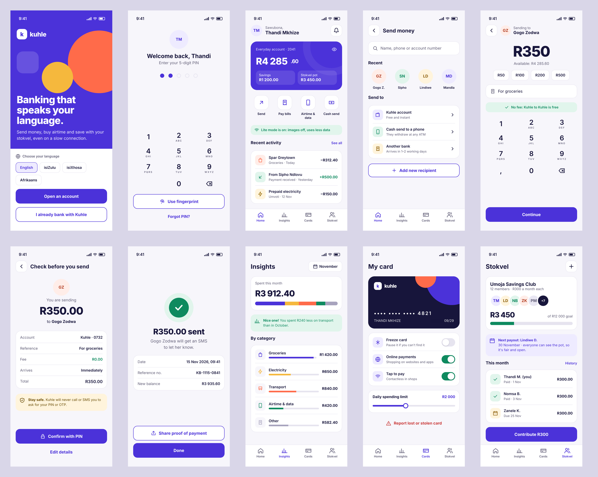

A mobile banking app designed for **first-time digital bankers in rural KwaZulu-Natal**: people who manage money with cash, airtime and stokvels, on prepaid data and entry-level phones.

| | |
| --- | --- |
| **Role** | UI/UX designer (solo): research, flows, wireframes, visual design, design system |
| **Platform** | Android and iOS app, 390 × 844 screens |
| **Tools** | Figma, HTML/CSS for the design source |
| **Type** | Concept project: Kuhle Bank is a fictional bank |
| **Figma** | [Design file and clickable prototype](https://www.figma.com/design/vgezsnnY4vQcGo2aKVJjET) |

---

## 1. The problem

Most banking apps assume **fast data, new phones and English**. In towns like Greytown, many people:
- buy data in small prepaid bundles, so heavy apps cost them money
- use entry-level Android phones with little storage
- speak isiZulu at home and only partly trust banking jargon
- are targeted by scam SMSes, so they fear pressing the wrong button

**Goal:** design an app a first-time user can confidently use to **send money, buy airtime, track spending and save with a stokvel**.

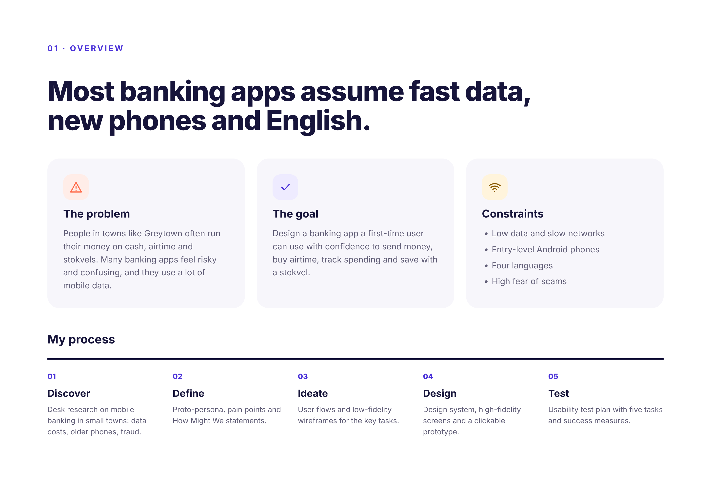

## 2. Who it's for

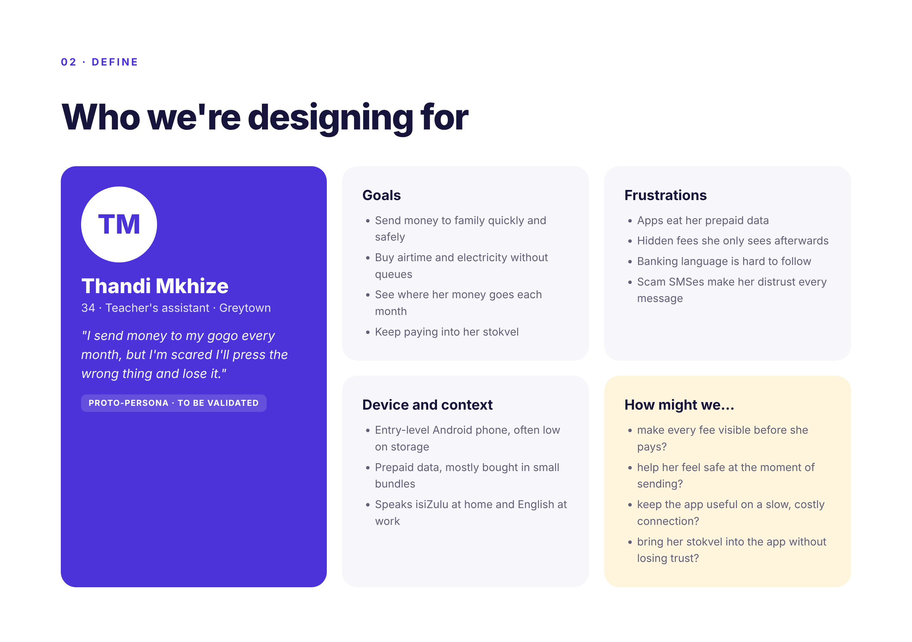

**Thandi Mkhize, 34, teacher's assistant in Greytown.** This is a *proto-persona*, based on assumptions and desk research, and should be validated with real users.

**How might we…**
- make every fee visible **before** she pays?
- help her feel safe at the moment of sending?
- keep the app useful on a slow, costly connection?
- bring her stokvel into the app without losing trust?

## 3. User flow: sending money

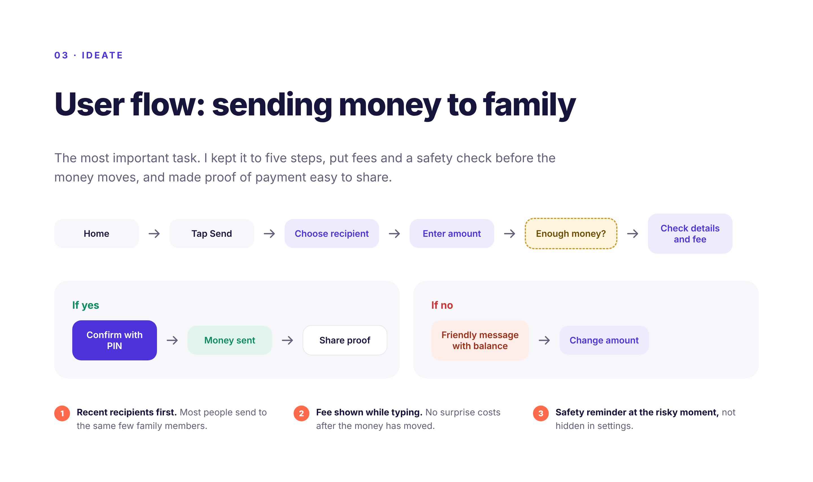

Sending money to family is the most important task, so it takes **five steps**. The fee and a safety check appear **before** the money moves, and the flow ends with **shareable proof of payment**.

## 4. Wireframes

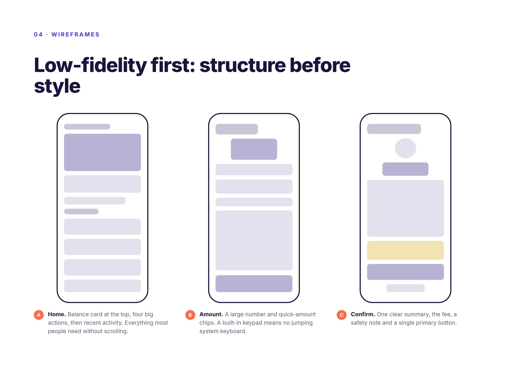

I worked out the structure in low fidelity first: the balance and the four main actions sit on the first screen, a built-in number pad replaces the jumping system keyboard, and the confirm screen has one clear primary button.

## 5. Design system

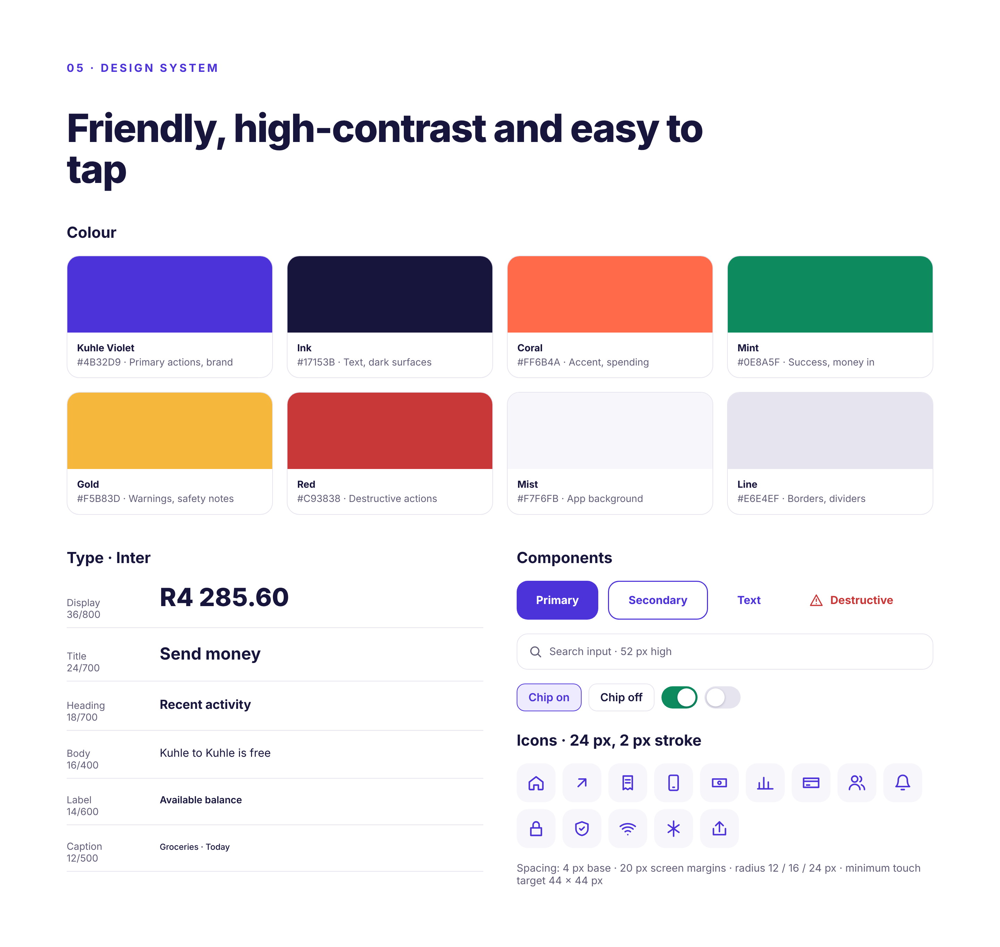

- **Colour:** Kuhle Violet `#4B32D9` for the brand and primary actions, Mint for money in and success, Coral for spending, and Gold for safety notes. Text contrast is at least 4.5:1.
- **Type:** Inter in six levels, from a 36 px display down to a 12 px caption.
- **Components:** buttons (primary, secondary, text, destructive), inputs, chips, toggles, list rows and a 24 px icon set.
- **Layout:** 4 px spacing base, 20 px screen margins and touch targets of at least 44 × 44 px.

## 6. Final screens

| | | | | |
| :---: | :---: | :---: | :---: | :---: |
| 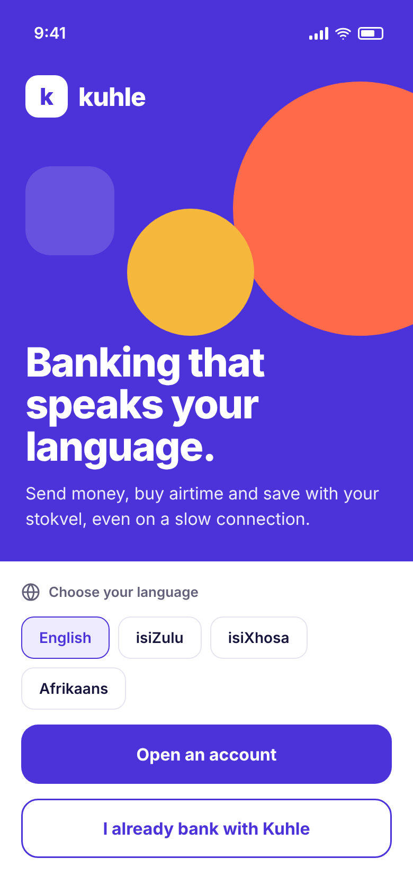 | 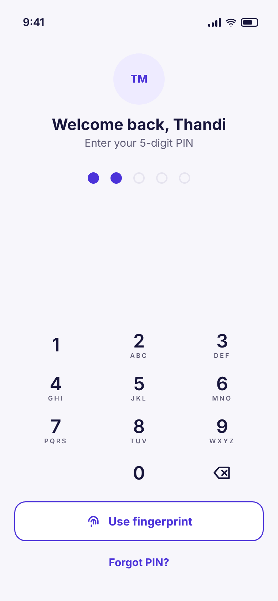 | 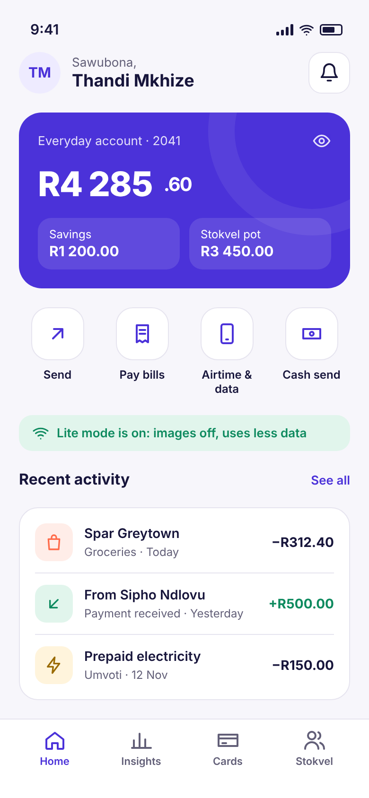 | 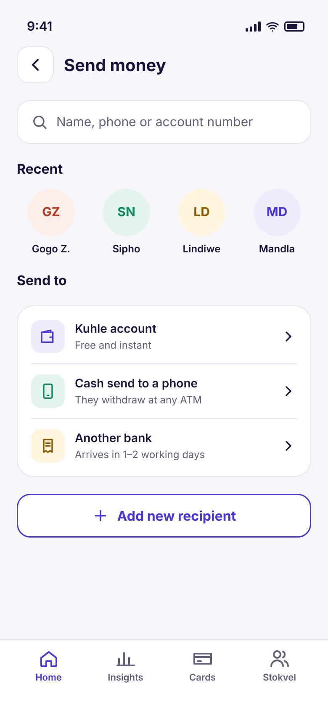 | 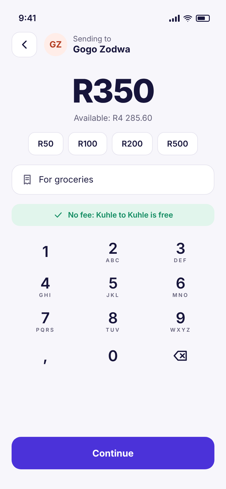 |
| **Welcome:** pick from 4 languages first | **PIN login** with a fingerprint option | **Home:** balance, 4 big actions, Lite mode | **Send:** recent family first | **Amount:** quick chips, fee shown live |
| 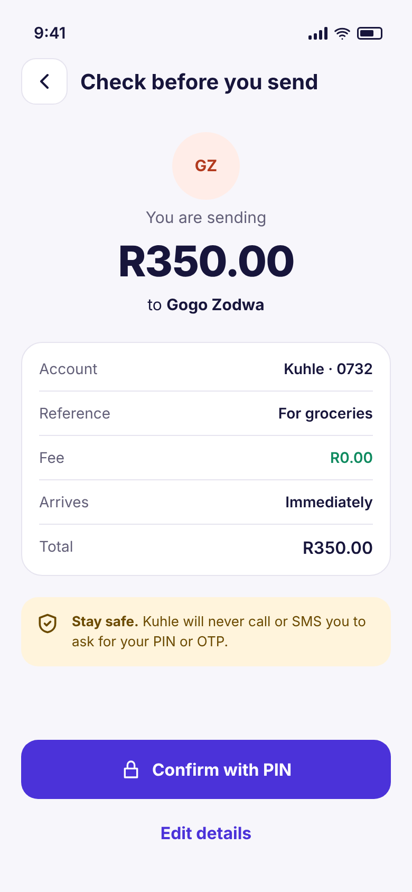 | 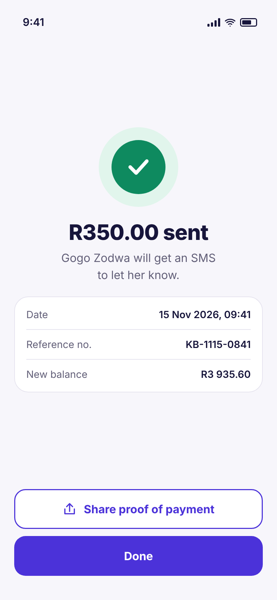 | 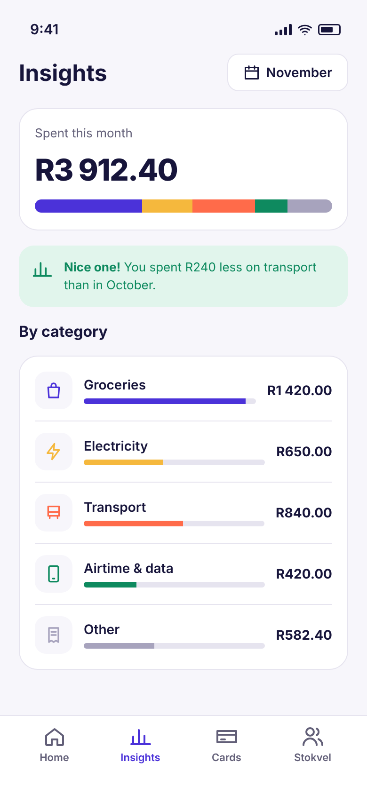 | 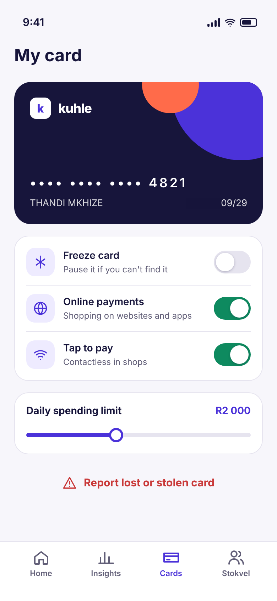 | 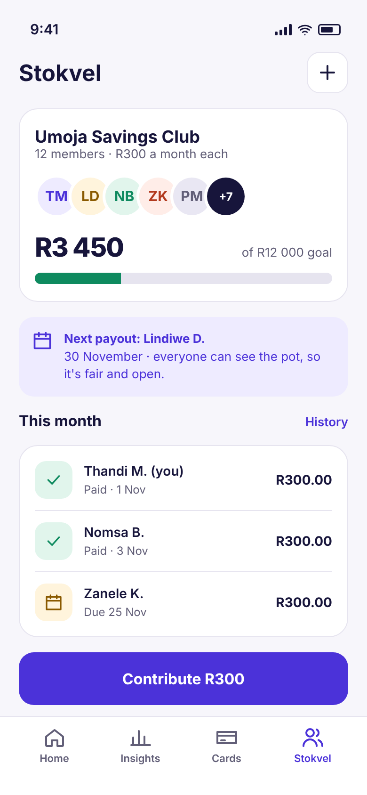 |
| **Confirm:** summary and scam warning | **Success:** share proof of payment | **Insights:** spending by category | **Card:** freeze, limits, report lost | **Stokvel:** a shared pot everyone can see |

## 7. Key UX decisions

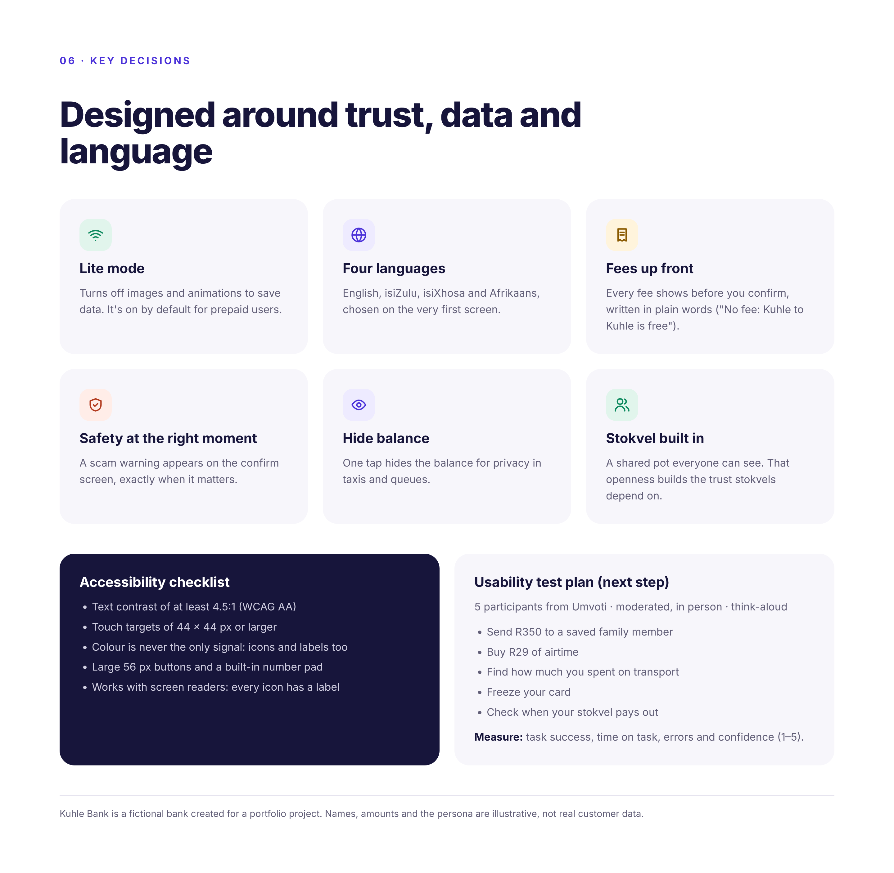

| Decision | Why |
| --- | --- |
| **Lite mode** on by default | Saves data for prepaid users: no images or animations |
| **Language chosen on screen one** | English, isiZulu, isiXhosa and Afrikaans |
| **Fees shown up front** in plain words | No surprise costs after the money moves |
| **Scam warning on the confirm screen** | Safety advice at the exact moment of risk |
| **Hide balance** | Privacy in taxis and queues |
| **Stokvel built in** | A visible shared pot keeps the group's trust |

## 8. Next step: usability testing

A planned moderated, think-aloud test with **5 participants from Umvoti**:
1. Send R350 to a saved family member
2. Buy R29 of airtime
3. Find how much you spent on transport
4. Freeze your card
5. Check when your stokvel pays out

**Measures:** task success, time on task, errors and confidence (rated 1–5).

## What I learned

- Designing for **trust** matters as much as designing for speed in financial apps.
- **Constraints** like data cost, older phones and language led to better, simpler design decisions.
- Planning the test before the research makes it clear what still needs validating.

---

### Files

```
├── screens/       ← 10 high-fidelity screens (PNG, 2x)
├── case-study/    ← cover, overview, persona, flow, wireframes, design system, decisions
└── source/        ← HTML/CSS design source and the Python scripts that generate it
```

*Kuhle Bank is fictional and was created for a portfolio project. Names, amounts and the persona are illustrative, not real customer data.*

**Designed by Ukhezo** · [GitHub](https://github.com/Ukhezo)
